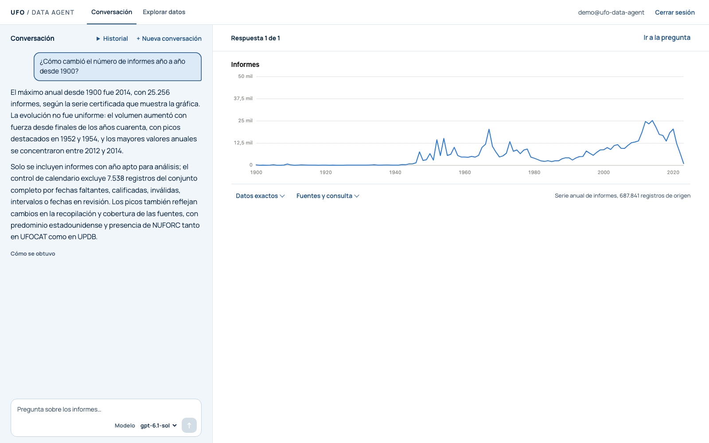
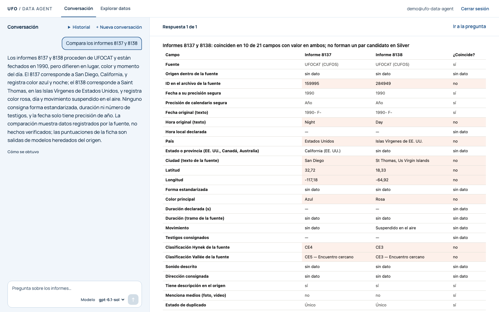

<div align="center">

# UFO Data Agent

### Un siglo de reportes de fenómenos aéreos, en una sola conversación

Un agente conversacional que responde preguntas en lenguaje natural sobre más de 702.000 informes de UAP. Consulta solo datos preparados y verificados, y devuelve cada respuesta con su gráfico, su evidencia y sus límites.

[Galería](docs/images/README.md) · [Certificación](docs/certificacion.md) · [Iniciar localmente](#inicio-rápido) · [Documentación](#documentación)

</div>

<p align="center">
  
</p>

## Una pregunta, un gráfico y su evidencia

El agente interpreta la pregunta, elige la consulta tipada sobre la carga Gold aprobada y muestra la visualización que la responde. Cada resultado indica cuántos informes entran, cuáles quedan fuera y por qué.

<p align="center">
  
  
</p>
<p align="center">
  
  
</p>
<p align="center">
  
  
</p>

## Qué puedes explorar

- **Tiempo:** año, década, mes, día, hora y día de la semana, con picos anómalos y cambios interanuales.
- **Geografía:** país, estado o provincia (EE. UU., Canadá y Australia), ciudad de la fuente, mapas de puntos, densidad, coropletas y globo 3D.
- **Descripción:** forma, color, movimiento, sonido, duración y testigos, con distribuciones, cuantiles y dispersión.
- **Proximidad:** distancia a instalaciones nucleares y enlaces entre celdas e instalaciones.
- **Procedencia y calidad:** fuentes, duplicados confirmados y pendientes, cobertura por campo y datos que faltan juntos.
- **Análisis:** 20 análisis tipados, entre ellos cascada, ranking acumulado, concentración, agrupaciones, embudo, UpSet, comparación de informes y K-means.

Gold integra UFOCAT, UPDB, UFO-search y Capella / PhenomAInon. La unidad es el **informe**: documenta lo que alguien declaró, no un hecho verificado. Las puntuaciones de modelo (engaño, calidad, sentimiento) se presentan como salidas de modelos heredados.

## Certificación

| Prueba | Resultado |
| --- | --- |
| Evaluación del agente con `gpt-6.1-sol` (60 preguntas) | **46 aprobadas**, 54 con cifras correctas |
| Banco de preguntas (`scripts/validar_preguntas.py`) | 122 de 126 con gráfico; las 4 restantes no tienen el dato |
| Pipeline, API y web | Pruebas unitarias, de API y e2e en verde; build de producción correcto |

Carga Gold `caca588120ee…` (890 controles). Detalle por pregunta y criterios en [docs/certificacion.md](docs/certificacion.md).

## Galería

La [galería completa](docs/images/README.md) reúne 87 capturas tomadas durante la certificación: las 60 preguntas del banco de evaluación y 24 preguntas que recorren todas las vistas y análisis, cada una con la respuesta real del modelo.

<p align="center">
  
  
</p>

## Inicio rápido

Ejecuta los comandos desde la raíz del repositorio.

### Demo con datos sintéticos

| Entorno | Comando |
| --- | --- |
| Windows o Windows Sandbox x64 | `.\scripts\windows\install_demo_windows.cmd` |
| Debian o Ubuntu (x64 o ARM64) | `bash scripts/install_demo_linux.sh` |

Los instaladores preparan Python y Node.js y llaman a `scripts/run_demo.py`.
En Windows, el `.cmd` abre PowerShell y ejecuta `scripts/windows/install_demo_windows.ps1`.
El lanzador instala las dependencias de la app, genera o reutiliza la muestra en
`data/demo/` y levanta la API y la web. Cuando aparezca **API y ejemplo verificados**,
abre el enlace que imprime y selecciona **Informes por fuente**. La consulta de
ejemplo se puede abrir sin iniciar sesión. [Guía de la demo](docs/arranque-muestra-gold.md).

Si ya tienes los requisitos del sistema, puedes iniciar directamente con
`python scripts/run_demo.py` en Windows o `python3 scripts/run_demo.py` en Linux.

### Carga completa con datos reales

Detén la demo con `Ctrl+C`. En Windows, con las dependencias de la app instaladas:

```powershell
.\scripts\windows\run_full_windows.cmd
```

El `.cmd` ejecuta `scripts/build_all.py` con el Python del entorno de la API.
Si el pipeline termina correctamente, ejecuta `npm.cmd --prefix apps/web run dev`.
La app usa la carga Gold aprobada en el catálogo de versiones. El script descarta
las variables que seleccionan la muestra para ese arranque.

En Windows también puedes ejecutar los dos pasos manualmente:

```powershell
python scripts/build_all.py
```

Cuando el pipeline termine correctamente, arranca la API y la web:

```powershell
npm.cmd --prefix apps/web run dev
```

En Linux o macOS, usa `python3 scripts/build_all.py` y luego
`npm --prefix apps/web run dev`. Si configuraste manualmente
`AGENT_GOLD_SERVING` o `AGENT_CERTIFIED_QUERIES`, quítalas de la sesión antes
del arranque manual con Gold completa.

## 1. Construir los datos (un solo comando)

Requisitos: Python 3.11+ con SQLite, `curl` solo para la primera descarga de
Bronze y ~4 GB libres. Guía completa, con Windows y la recuperación tras un
fallo: [docs/pipeline-local.md](docs/pipeline-local.md).

```bash
python3 scripts/build_all.py          # macOS / Linux
py -3.12 scripts\build_all.py         # Windows (PowerShell)
```

`build_all.py` llama a las funciones de estos módulos en orden:

| Etapa | Módulo | Resultado |
| --- | --- | --- |
| Bronze | `scripts/build_bronze.py` | Descarga o reutiliza y valida la base original. |
| Silver | `scripts/build_silver.py` | Construye y valida la capa normalizada desde Bronze. |
| Gold | `scripts/build_gold.py` | Construye la base analítica desde Silver aprobada. |
| Caché de servicio | `scripts/discover_gold.py` | Prepara los artefactos de consulta que usa la API. |

El pipeline también verifica y certifica Gold antes de aprobar la carga. Para
el flujo completo, basta con ejecutar `build_all.py`.

Construye Bronze → Silver → Gold → `ready_for_agent` y se detiene en el primer
paso que falle. Cada capa se construye en una versión nueva bajo
`data/<capa>/versions/` y se promueve con una sola transacción en
`data/releases.sqlite3`, después de pasar todos sus controles. Hasta entonces
sigue vigente la versión aprobada anterior, aunque el proceso falle o se
interrumpa. Solo un build publica a la vez. Si Bronze ya está en el disco, no
hace falta Internet.

```bash
python3 scripts/build_all.py --desde silver   # Silver y Gold (Bronze se reutiliza)
python3 scripts/build_all.py --desde gold     # solo Gold, sobre la Silver aprobada
python3 scripts/build_all.py --estado         # versiones aprobadas
python3 scripts/build_all.py --actualizar-referencias   # copiar certificaciones y evaluaciones a config/ y docs/
```

Gold solo acepta una Silver con un informe válido (`passed: true`), sin cambios
después de validarla, construida desde la Bronze oficial (tamaño y SHA-256) y
al día con la política y el código actuales. Si no, indica el motivo y pide
regenerar con `--desde silver`. El build no reescribe las referencias
versionadas: los resultados de cada carga se guardan en su versión.

## 2. Ejecutar la aplicación

Para probar la web y la API desde un clon limpio con datos sintéticos, sigue la
[guía de arranque con una muestra Gold](docs/arranque-muestra-gold.md).

```bash
python3.14 -m venv apps/api/.venv
apps/api/.venv/bin/python -m pip install -e apps/api
npm --prefix apps/web ci
npm --prefix apps/web run dev        # web + API (solo web: run dev:web)
```

Abre `http://127.0.0.1:3000` (no `localhost`, para conservar la cookie de ChatGPT).
La API sirve la carga Gold aprobada en el catálogo. Una carga nueva se activa al
reiniciarla, y `/api/health` muestra su `load_id`.

## Documentación

- Producto y diseño: [PRODUCT.md](PRODUCT.md), [DESIGN.md](DESIGN.md)
- Silver: [contrato](data/silver/README.md), [contrato analítico](docs/silver-contract.md), [revisión](docs/silver-review.md)
- Pipeline local: [operación en macOS y Windows](docs/pipeline-local.md)
- Gold: [contrato](docs/gold-contract.md), [catálogo](docs/GOLD_CATALOG.md), [guía de dominio](docs/gold-domain-guide.md), [verificación](docs/gold-verification.md)

Límites: un informe no es un hecho verificado; hay duplicados pendientes, sesgos
por fuente y época, y parte de los valores procede de evidencia externa.
