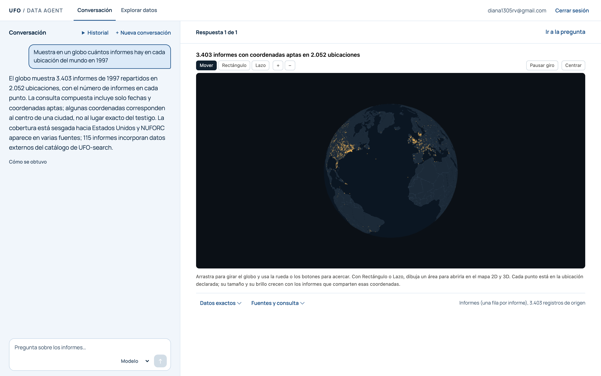
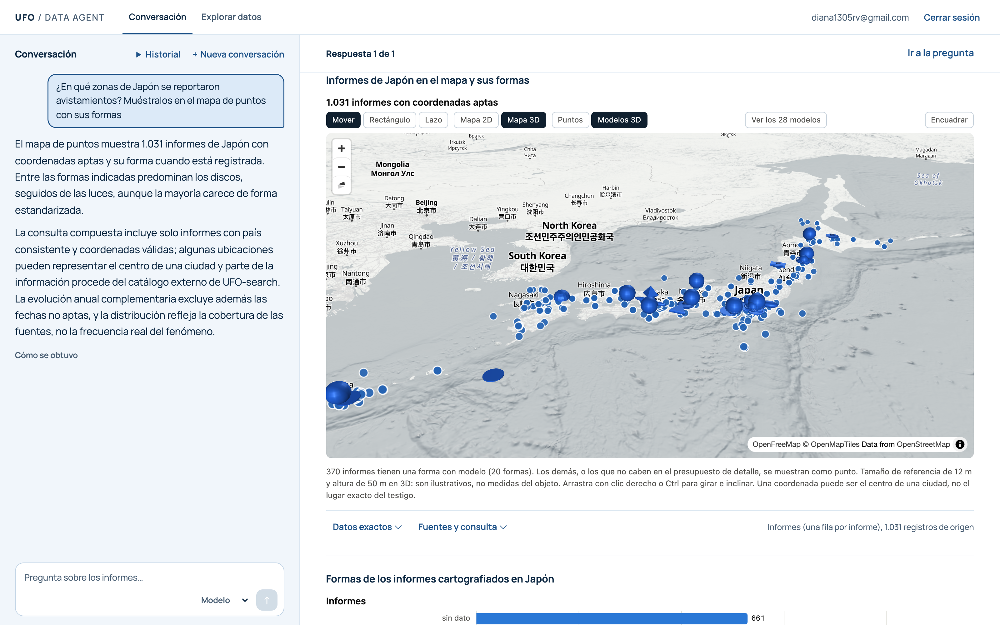
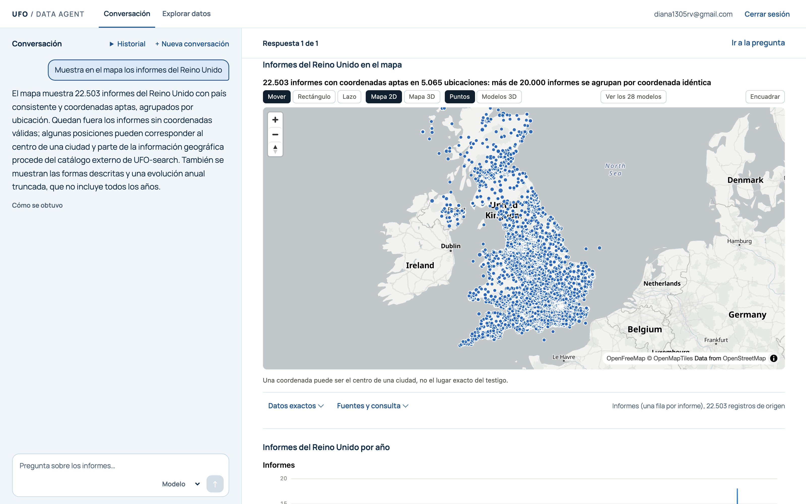
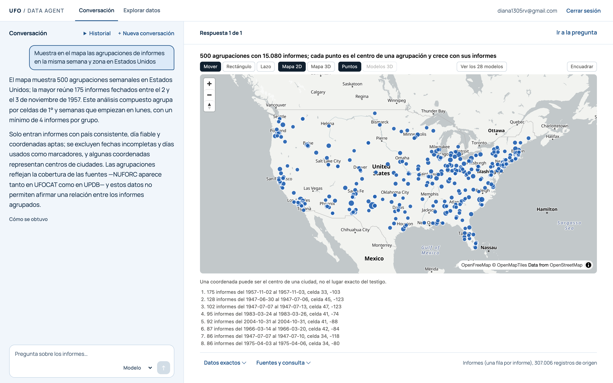
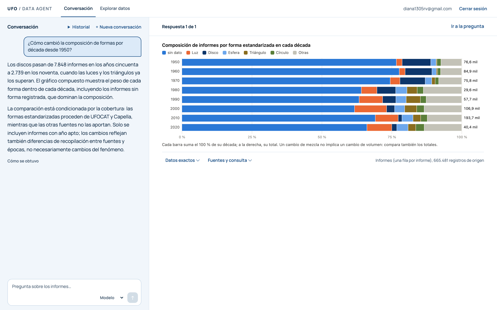
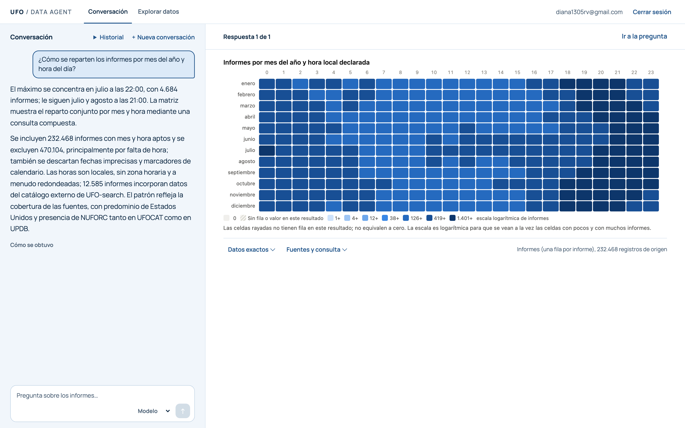
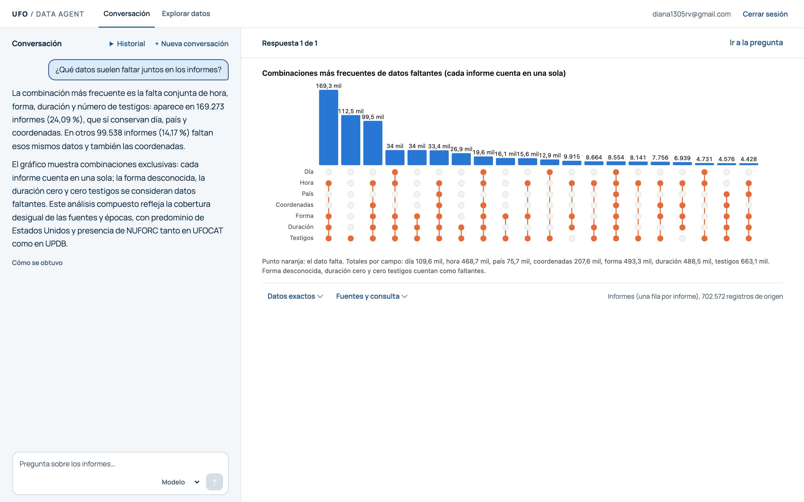
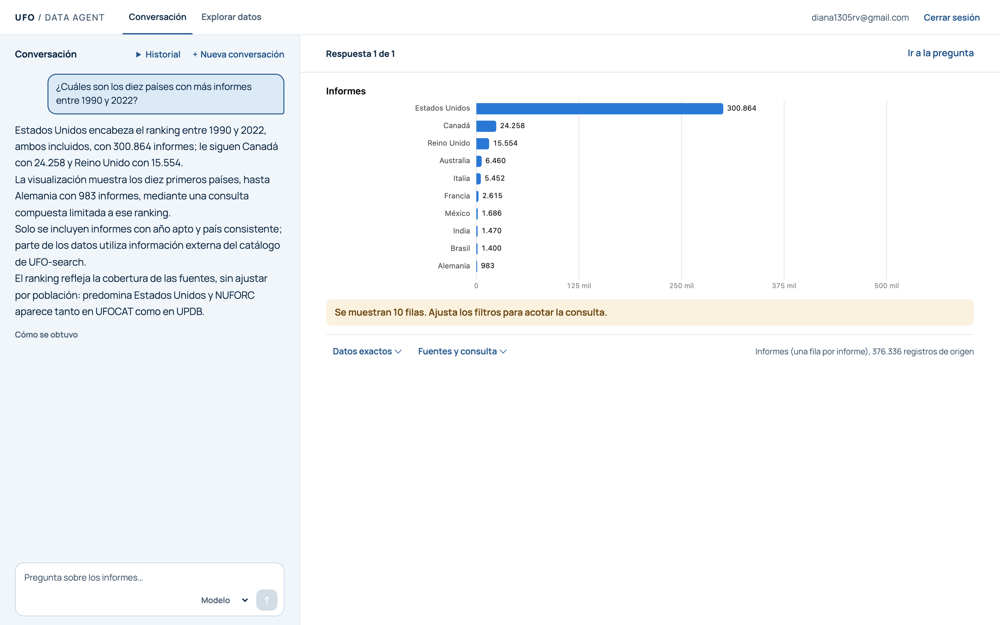

# UFO Data Agent

### Un siglo de reportes de fenómenos aéreos, en una sola conversación

Un agente conversacional que responde preguntas en lenguaje natural sobre más de 702.000 informes de UAP. Consulta solo datos preparados y verificados, y devuelve cada respuesta con su gráfico, su evidencia y sus límites.

[Galería](docs/images/README.md) — [Certificación](docs/certificacion.md) — [Iniciar localmente](#inicio-rápido) — [Documentación](#documentación)

  

## Una pregunta, un gráfico y su evidencia

El agente interpreta la pregunta, elige la consulta tipada sobre la carga Gold aprobada y muestra la visualización que la responde. Cada resultado indica cuántos informes entran, cuáles quedan fuera y por qué.

  
  

  
  

  
  

## Qué puedes explorar

- **Tiempo:** año, década, mes, día, hora y día de la semana, con picos anómalos y cambios interanuales.
- **Geografía:** país, estado o provincia (EE. UU., Canadá y Australia), ciudad de la fuente, mapas de puntos, densidad, coropletas y globo 3D.
- **Descripción:** forma, color, movimiento, sonido, duración y testigos, con distribuciones, cuantiles y dispersión.
- **Proximidad:** distancia a instalaciones nucleares y enlaces entre celdas e instalaciones.
- **Procedencia y calidad:** fuentes, duplicados confirmados y pendientes, cobertura por campo y datos que faltan juntos.
- **Análisis:** 20 análisis tipados, entre ellos cascada, ranking acumulado, concentración, agrupaciones, embudo, UpSet, comparación de informes y K-means.

El agente integra UFOCAT, UPDB, UFO-search y Capella / PhenomAInon. La unidad es el **informe**: documenta lo que alguien declaró, no un hecho verificado. Las puntuaciones de modelo (engaño, calidad, sentimiento) se presentan como salidas de modelos heredados.

## Galería

La [galería completa](docs/images/README.md) reúne 87 capturas tomadas durante la certificación: las 60 preguntas del banco de evaluación y 24 preguntas que recorren todas las vistas y análisis, cada una con la respuesta real del modelo.

  
  

## Inicio rápido

La demo con datos sintéticos, la carga completa con datos reales, el pipeline Bronze → Silver → Gold y el arranque de la API y la web están en [docs/inicio-rapido.md](docs/inicio-rapido.md).

## Documentación

- [Inicio rápido y operación](docs/inicio-rapido.md)
- Producto y diseño: [PRODUCT.md](PRODUCT.md), [DESIGN.md](DESIGN.md)
- Gold: [contrato](docs/gold-contract.md), [catálogo](docs/GOLD_CATALOG.md), [guía de dominio](docs/gold-domain-guide.md), [verificación](docs/gold-verification.md)
- Agente: [grafo LangGraph](docs/agente-langgraph.md), [preguntas y gráficos](docs/preguntas-y-graficos.md), [certificación](docs/certificacion.md)

## Tecnologías

             

