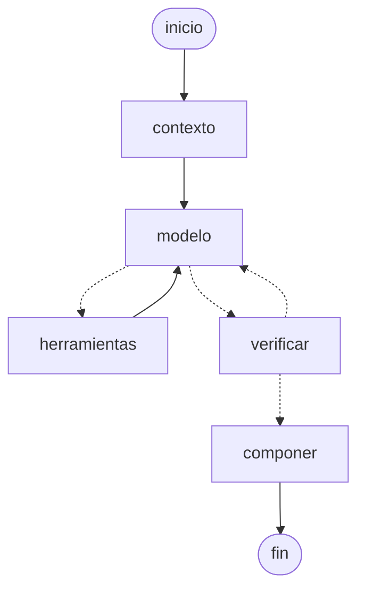

# Agente: grafo LangGraph

El Data Agent responde cada pregunta recorriendo un grafo de estados de LangGraph
([`apps/api/src/app/agent/graph.py`](../apps/api/src/app/agent/graph.py)). El
modelo decide qué herramientas tipadas llama; el grafo fija el orden, los
límites y las comprobaciones. El modelo nunca escribe SQL ni ve Gold directamente:
solo recibe los resultados compactos de las herramientas.

Las flechas discontinuas son decisiones. El diagrama se genera con
`build_graph(...).get_graph().draw_mermaid()` y una prueba comprueba que estas
aristas coinciden con las del grafo compilado.

## Estado

| Campo | Contenido |
| --- | --- |
| `question`, `model` | Pregunta y modelo elegido |
| `history` | Turnos anteriores de la conversación, con su evidencia verificada |
| `area` | Área dibujada en un mapa, si está activa (polígono `[lng, lat]`) |
| `inputs` | Mensajes y llamadas que se envían al modelo (acumulativo) |
| `calls` | Herramientas pedidas por el modelo en la última vuelta |
| `visuals` | Resultados completos de Gold; cada uno es una visualización (acumulativo) |
| `trace` | Cada herramienta llamada, con sus argumentos o su error (acumulativo) |
| `rounds`, `charts`, `rewrites` | Vueltas del modelo, visualizaciones producidas y reescrituras (acumulativos) |
| `turn` | El turno final que devuelve y guarda la API |

Los campos acumulativos usan reductores (`Annotated[list, operator.add]`): cada
nodo devuelve solo lo que añade. La cuenta que paga la inferencia y el transporte
viajan en la configuración de la ejecución (`configurable`), nunca en el estado,
así que un checkpointer no podría guardar credenciales.

## Nodos

1. **contexto.** Añade los últimos 12 turnos con su evidencia verificada (el
   turno anterior conserva hasta 60 filas por resultado; los anteriores, un
   resumen) y, si hay un área activa, la nota que la explica.
2. **modelo.** Una llamada a Responses con `parallel_tool_calls`: el modelo pide
   en un solo paso todo lo que no depende de otra llamada. Si pide herramientas,
   pasa a *herramientas*; si responde con texto, pasa a *verificar*. Cuando se
   agota el presupuesto de vueltas (10, más 2 por cada visualización producida,
   hasta 18), la última llamada va con `tool_choice: none` y una nota que pide
   responder con lo que ya hay: el turno siempre termina con una respuesta.
3. **herramientas.** Ejecuta todas las llamadas del paso: `search_certified`,
   `run_certified`, `query_gold`, `analyze`, `find_entities` y `describe_data`.
   `analyze` corre uno de los análisis tipados de
   [scripts/gold_analysis.py](../scripts/gold_analysis.py) (cascada, anomalías,
   ranking, clusters, K-means, comparación de informes…) y cuenta como una
   visualización; un análisis repetido no se vuelve a dibujar. Un error del
   contrato, o un fallo inesperado de una herramienta, vuelve al modelo con su
   código para que corrija los argumentos. Con un área activa, la API la añade a
   cada `query_gold` y a cada `analyze`.
4. **verificar.** Comprobaciones deterministas sobre la respuesta: que haya
   texto legible, una sola cifra sin rangos de informes (regla de
   [PRODUCT.md](../PRODUCT.md)), ninguna frase prohibida (tampoco negada:
   “no está comprobado”), nada de Markdown y ningún nombre de columna, dataset o
   código de consulta. Si algo falla, pide una reescritura sin herramientas
   (`tool_choice: none`) que lista lo que hay que corregir; a la segunda acepta
   la respuesta para no entrar en un bucle. Una respuesta sin ninguna
   herramienta, sin evidencia previa y sin pregunta de vuelta recibe un aviso
   (`no_data_used`) para consultar Gold, esta vez con herramientas: lo que el
   modelo recuerda nunca es evidencia.
5. **componer.** Arma el turno: respuesta, visualizaciones, traza, carga Gold y
   `visualization_action`.

## Optimización

- **Una sola compilación.** El grafo, las instrucciones y los esquemas de las
  herramientas se construyen una vez por carga Gold y los comparten todas las
  peticiones. Las instrucciones son un prefijo estable, apto para la caché de
  prompts del proveedor.
- **Entidades en las instrucciones.** Todos los ids reales (países, fuentes,
  orígenes, colecciones, formas, colores e instalaciones) van en las
  instrucciones: el modelo filtra directamente y `find_entities` queda para
  nombres ausentes o ambiguos (Congo, Corea), lo que ahorra una vuelta.
- **Certificada en el mismo paso.** Cuando `search_certified` encuentra una
  certificada válida con cobertura total y explícita (los `needs` declaran
  filtros o agrupación), la ejecuta y la muestra en ese paso
  (`decision.executed`, con una entrada `run_certified` marcada `auto` en la
  traza). Las preguntas frecuentes se responden con dos llamadas al modelo.
  Unos `needs` vacíos “cubren” cualquier candidata, así que entonces decide el
  modelo.
- **Cobertura por desglose.** Un total pedido a una certificada con fila de
  total (`rollup`) está cubierto, y un filtro `eq` sobre la columna por la que
  agrupa la certificada también (“¿cuántos vienen de NUFORC?” sobre informes
  por origen): el servidor comprueba que la fila está en el resultado y la
  devuelve en `focus_rows`.
- **Empates en la búsqueda.** Las preguntas cortas empatan a menudo; gana la
  certificada con el ejemplo más parecido a la pregunta, no la primera por id.
- **Sin repeticiones.** Una consulta igual a otra ya mostrada en la respuesta
  (salvo el título) no se vuelve a ejecutar ni a dibujar. Releer datos ya
  mostrados, ordenados o recortados (“¿qué año tuvo más?”), responde al modelo
  sin dibujarse otra vez; cada resultado trae `extremes`, máximos y mínimos
  sobre todas sus filas, porque el modelo solo lee 60.
- **Valores válidos.** Las instrucciones incluyen los códigos permitidos de las
  columnas categóricas pequeñas (bandas de distancia, duración, familias de
  color, motivos de exclusión) y la guía de dominio; un valor desconocido
  devuelve la lista de permitidos en vez de mandar a `find_entities`.
- **Transporte.** Una conexión cortada o un 5xx antes de la respuesta se
  reintenta una vez; los 4xx y los streams fallidos o incompletos no.

## Continuidad entre turnos

- `visualization_action` es `create` cuando el turno trae resultados nuevos y
  `retain` cuando no (una aclaración o un comentario). Con `retain`, la web
  sigue mostrando los resultados anteriores, como en el contrato del agente de
  Messi.
- El área seleccionada en un mapa limita todas las preguntas siguientes hasta
  que se quita.
- Cada turno guarda sus consultas; el siguiente las recibe como evidencia para
  modificar solo lo que pide la pregunta.

## Diferencia con el agente de Messi

El agente de Messi ejecuta un `StateGraph` de dos nodos (modelo ⇄ herramientas)
con reductores, llamadas en paralelo, entidades en las instrucciones, credenciales
en la configuración y un presupuesto de vueltas que crece con cada gráfico. Este
grafo adopta todo eso y añade nodos explícitos de contexto y verificación, la
ruta certificada en un solo paso y un cierre que siempre responde al agotar el
presupuesto.

Del agente de Messi también toma las herramientas dedicadas a cálculos que una
consulta no expresa (`match_result`, `lineup_story`): aquí es `analyze`, con un
análisis tipado por familia de preguntas. El dominio UFO es abierto, así que en
vez de ampliar el contrato genérico con cada estadístico, cada análisis calcula
en el servidor y devuelve filas para una vista existente o nueva. La cobertura
de preguntas resultante está en [preguntas-y-graficos.md](preguntas-y-graficos.md).

## Pruebas

`apps/api/tests/test_runtime.py` recorre el grafo con un modelo simulado:
respuesta directa, consulta certificada, reparación de errores, llamadas en
paralelo en un solo paso, credenciales fuera del estado, cierre al agotar el
presupuesto, fallos inesperados de herramientas, reescritura por rango, frase
prohibida, Markdown o códigos, reintento del transporte y `visualization_action`.
`apps/api/tests/test_tools.py` cubre la certificada ejecutada en la búsqueda,
la cobertura por desglose y por total, los `needs` vacíos, los empates, la
deduplicación, la relectura sin dibujo, `extremes` y los valores permitidos.

`scripts/run_agent_evals.py` evalúa con el modelo real (`--model gpt-6.1-sol`).
Además del criterio estricto (`passed`), cuenta `figures_correct`: respuestas
cuyas cifras coinciden con la referencia aunque el resultado tenga otra forma
(otro orden, otro límite, columnas de más). Cada resultado guarda la traza con
argumentos y errores.
